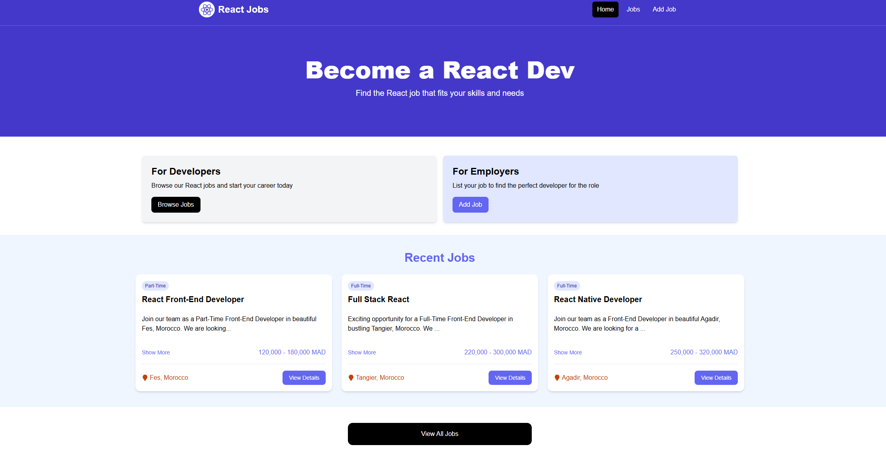

#Job-post

# Job Postings App

A React application with Firebase Firestore backend for managing job postings.

 

## Features

- 📝 Create, read, update, and delete job postings
- 🔒 Firebase Authentication (optional)
- 📱 Responsive design
- ⚡ Real-time database updates

## Technologies

- React.js + Vite
- Firebase Firestore (Database)
- Firebase Authentication (optional)
- Tailwind CSS (optional)

## Setup Instructions

### 1. Prerequisites

- Node.js (v16+)
- npm/yarn
- Firebase account

### 2. Firebase Configuration

1. Create a new Firebase project at [console.firebase.google.com](https://console.firebase.google.com/)
2. Register a new web app in your Firebase project
3. Get your Firebase config object (it will look like this):

```javascript
const firebaseConfig = {
  apiKey: "YOUR_API_KEY",
  authDomain: "your-project.firebaseapp.com",
  projectId: "your-project-id",
  storageBucket: "your-project.appspot.com",
  messagingSenderId: "123456789",
  appId: "1:123456789:web:abc123def456"
};
```

### 3. Environment Setup

1. Create `.env` file in project root:

```env
VITE_FIREBASE_API_KEY=your_api_key
VITE_FIREBASE_AUTH_DOMAIN=your-project.firebaseapp.com
VITE_FIREBASE_PROJECT_ID=your-project-id
VITE_FIREBASE_STORAGE_BUCKET=your-project.appspot.com
VITE_FIREBASE_MESSAGING_SENDER_ID=123456789
VITE_FIREBASE_APP_ID=1:123456789:web:abc123def456
```

2. Never commit this file! Ensure it's in your `.gitignore`

### 4. Install Dependencies

```bash
npm install
# or
yarn install
```

### 5. Run Development Server

```bash
npm run dev
# or
yarn dev
```

The app will run on [http://localhost:5173](http://localhost:5173)

## Deployment

### Vercel Deployment

1. Push your code to a GitHub repository
2. Go to [Vercel](https://vercel.com/) and import the project
3. Add all environment variables from your `.env` file
4. Deploy!

### Firebase Hosting

1. Install Firebase CLI:
```bash
npm install -g firebase-tools
```

2. Login and initialize:
```bash
firebase login
firebase init hosting
```

3. Deploy:
```bash
npm run build
firebase deploy
```

## Firestore Rules Setup

Set these rules in Firebase Console → Firestore → Rules:

```javascript
rules_version = '2';
service cloud.firestore {
  match /databases/{database}/documents {
    match /jobs/{jobId} {
      allow read, write: if true; // For development only
      // For production:
      // allow read: if true;
      // allow write: if request.auth != null;
    }
  }
}
```

## Troubleshooting

### Common Issues

1. **Firestore Connection Errors**:
   - Verify all environment variables are correct
   - Check browser console for errors
   - Disable ad blockers/extensions

2. **Missing Dependencies**:
   ```bash
   rm -rf node_modules package-lock.json
   npm install
   ```

3. **CORS Errors**:
   - Ensure proper Firestore rules are set
   - Verify domain is authorized in Firebase Console

## Project Structure

```
src/
├── components/       # Reusable components
├── firebase/         # Firebase initialization
├── pages/            # Main views
├── services/         # API/Firebase services
├── App.jsx           # Main component
└── main.jsx          # Entry point
```

## Contributing

1. Fork the repository
2. Create your feature branch (`git checkout -b feature/fooBar`)
3. Commit your changes (`git commit -am 'Add some fooBar'`)
4. Push to the branch (`git push origin feature/fooBar`)
5. Create a new Pull Request

## License

MIT © [Ahmed-rbr]
